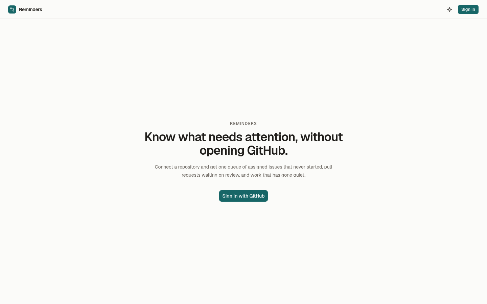

# Reminders

Know what needs attention, without opening GitHub.

<p align="left">
  <a href="https://reminders.franciscapt.dev"></a>
  <a href="https://github.com/franpts2/reminders/actions/workflows/deploy.yml"></a>
  <a href="LICENSE"></a>
</p>

<p align="left">
  
  
  
  
  
</p>

## About

Reminders is an inbox for the work a project manager has to chase: issues that were handed out but never started, pull requests waiting on review, approvals that never merged, and work that has gone quiet. It signs in with GitHub, reads public repositories, and puts every project's reminders into one queue ordered by how long each has been waiting.

It is built for one person managing several repositories at once. GitHub access is read-only, and all state lives in Cloudflare D1.

**Live:** [reminders.franciscapt.dev](https://reminders.franciscapt.dev)

## Screenshot



The signed-out landing page. After signing in, the same shell becomes the inbox.

## Features

- **One inbox** — every project's reminders in a single queue, ordered by how long each has been waiting.
- **Snooze and dismiss** — snooze for a day, three days or a week; dismiss with a five-second undo.
- **Seen means on screen** — a reminder is marked seen only once it has actually rendered, so the sidebar count reflects unread work.
- **Shareable filters** — filter by project and rule, sort oldest or newest first, and keep the whole view in the URL.
- **Per-project rules** — a page for each project with thresholds, live counts, scan history and deletion.
- **Scan on demand or on schedule** — scan a project from its page, or run `GET /api/scan` from an external scheduler.
- **Keyboard, touch and mouse** — `j`/`k` navigation on desktop, swipe actions on touch, and hover actions everywhere.

### Inbox behaviour

- **Groups** are Over a week, This week and Today, ordered oldest first by default.
- **The left bar** is teal when a reminder appeared in the most recent scan or is still unread, and muted when it was carried over and has been seen.
- **Seen** means "was on screen for a moment", not "the inbox was opened".
- **Keyboard**: `j` / `k` move, `Enter` opens on GitHub, `d` dismisses, `s` snoozes three days, `Escape` clears the selection.
- **Touch**: swipe a reminder left to dismiss or right to snooze three days; in Snoozed a right swipe brings it back. The snooze button opens a bottom sheet with 1 day, 3 days and 1 week, and the mobile sidebar closes with a left drag.
- **Mouse**: hover a reminder for dismiss, snooze (a day, three days or a week) and open-on-GitHub actions.

## Quick Start

Requirements: Node.js 22, npm, a GitHub OAuth app, and a Cloudflare account for Wrangler and D1.

Before the first run:

1. Create a GitHub OAuth app (GitHub → Settings → Developer settings → OAuth Apps → New OAuth App) with the callback URL `http://localhost:5173/auth/callback`. Copy the **Client ID** and **Client Secret**.
2. Create the D1 database with `npx wrangler d1 create github-pm-reminders-db` and put the `database_id` from its output into `wrangler.toml`.
3. Copy `.dev.vars.example` to `.dev.vars` and fill in `GITHUB_CLIENT_ID`, `GITHUB_CLIENT_SECRET`, `SESSION_SECRET` (any long random string) and `APP_URL`.

Then:

```bash
git clone git@github.com:franpts2/reminders.git
cd reminders
npm install
npm run db:migrate:local
npm run dev
```

Open [http://localhost:5173](http://localhost:5173). Bindings and `wrangler.toml` vars are emulated and `.dev.vars` is loaded.

If "Sign in with GitHub" lands on a GitHub 404, `GITHUB_CLIENT_ID` is still the placeholder or does not match a real OAuth app. `npm run check:oauth` verifies that the local client ID and secret belong together without starting the app or using a real OAuth code.

## Configuration

| Variable | Required | Description |
| --- | --- | --- |
| `GITHUB_CLIENT_ID` | yes | Client ID from the GitHub OAuth app; set in `wrangler.toml` and `.dev.vars` |
| `GITHUB_CLIENT_SECRET` | yes | Client secret from the GitHub OAuth app; set as a secret |
| `SESSION_SECRET` | yes | Long random string used to sign sessions |
| `APP_URL` | yes | Public origin, such as `https://reminders.franciscapt.dev`; must match the OAuth callback |
| `CRON_SECRET` | no | Shared secret for `GET /api/scan`; only needed for scheduled scans |

`wrangler.toml` also needs the real D1 `database_id` and KV namespace `id`. For production, set the secrets once:

```bash
npx wrangler secret put GITHUB_CLIENT_SECRET
npx wrangler secret put SESSION_SECRET
npx wrangler secret put CRON_SECRET
```

Deploys do not touch them.

## How It Works

- **Scans are idempotent.** One reminder row per project, rule and item; a still-true match refreshes in place, so seen and snooze state survives rescans.
- **Two ways in.** "Scan now" scans a single project, while `GET /api/scan` with an `x-cron-secret` header scans every project for an external scheduler.
- **GitHub stays read-only.** OAuth is used to read issues and pull requests; nothing is written back.
- **Seen is measured, not assumed.** Rows report visibility with an `IntersectionObserver`, so unread counts reflect what actually appeared on screen.
- **The URL holds the view.** Project, rule and sort live in the query string and are mirrored with `replaceState`, so reloads and shared links keep their filters.
- **D1 for state, KV for sessions.** Reminders, projects and scan history live in D1; sessions live in KV.

## Reminder rules

| Rule | Fires when |
| --- | --- |
| Assigned but not started | An assigned issue has no linked PR and/or has not moved to In Progress |
| PR open too long | A pull request has been open past the threshold |
| Needs review | A pull request is waiting for a first review, or a re-review after new commits, past the threshold |
| Changes requested | A pull request has changes requested and the author has not pushed since |
| Approved but not merged | An approved pull request has not been merged past the threshold |
| Merge conflicts | A pull request has had unresolved merge conflicts past the threshold |
| No activity | An issue or PR has had no activity past the threshold |
| Stuck in project column | Shown but disabled: requires the GitHub Projects v2 API |

"Counts as started" is configurable per rule: a linked PR, movement to In Progress, or both.

## Reminder lifecycle

Each project, rule and item owns exactly one reminder row:

- a new match creates it as **open**
- a match that is still true refreshes its message and assignee, keeping seen and snooze state
- a condition that stops matching marks it **resolved**
- a condition that comes back **reopens** it as unread
- a reminder you **dismiss** stays dismissed until you restore it, and the scanner will not recreate it

Disabling a rule resolves the reminders it already produced.

## Testing

There is no automated test suite yet. The static check runs `svelte-check` against the TypeScript config and is the same check CI runs before every build:

```bash
npm run check
```

## Deployment

```bash
npm run build
npm run db:migrate:prod
npm run deploy
```

Migrations are additive, so run them before deploying code that needs new columns.

### Continuous deployment

Pushing to `main` runs `.github/workflows/deploy.yml`, which checks the project, builds it, applies pending D1 migrations and deploys the Worker. Pull requests to `main` run the same checks without deploying.

Before the first automated deploy, configure the repository:

1. Create a Cloudflare API token with **Workers Scripts: Edit**, **D1: Edit** and **Workers KV Storage: Edit** for the account, then add it as the `CLOUDFLARE_API_TOKEN` repository secret.
2. Add the account's ID as the `CLOUDFLARE_ACCOUNT_ID` repository secret.
3. Set the production secrets with `wrangler secret put` as shown in [Configuration](#configuration).
4. Optionally require reviewers on the `production` GitHub environment if deploys should need manual approval.

### Scheduled scans

There are two ways to scan:

1. **Scan now** on a project page
2. `GET /api/scan` with an `x-cron-secret` header matching `CRON_SECRET`, which scans every project

Point an external scheduler (cron-job.org, GitHub Actions, a Worker cron) at the endpoint; hourly is a sensible default.

## Project Structure

```text
src/
  lib/
    components/         # shell, reminder row, tooltips, theme toggle
    scanner.ts          # GitHub reads and reminder rules
    reminder-service.ts # open, refresh, resolve, reopen, dismiss
    db.ts               # D1 queries and row types
  routes/
    inbox/              # inbox and snoozed views
    projects/           # project list, rules pages and settings
    api/scan/           # scheduled scan endpoint
    api/reminders/seen/ # seen tracking
    auth/               # GitHub OAuth
migrations/             # additive D1 migrations
scripts/                # OAuth credential check
docs/screenshots/       # README images
.github/workflows/      # CI/CD
wrangler.toml
```

## Roadmap

- [x] One inbox with grouping, filters, snooze and dismiss
- [x] Per-project rules with thresholds and scan history
- [x] Keyboard, touch and mouse interaction
- [ ] "Stuck in project column" via GitHub Projects v2
- [ ] Email, Slack or desktop notifications
- [ ] Team invitations and organisation-level views

## Limits

- Public repositories only.
- A scan reads the first 100 open issues and 100 open pull requests per repository.
- "Stuck in project column" needs GitHub Projects v2 and is not implemented.
- No email, Slack or desktop notifications; everything is in-app.
- A project belongs to the user who created it; there are no team or organisation-level views yet.

## License

MIT © 2026 Francisca Portugal. See [LICENSE](LICENSE).

---

_Reminders — know what needs attention, without opening GitHub._
